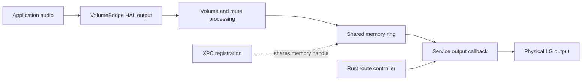

# Audio path and native volume control

VolumeBridge adds a HAL output named **LG ULTRAGEAR+ · VolumeBridge**. It contains
one stereo stream at 48 kHz, a volume control, and a mute control. Applications can
select this output through the normal macOS sound interface. The physical LG
output remains a separate device; VolumeBridge does not patch an Apple endpoint.

## Ownership and data flow



The C++ driver implements the libASPL plugin contract. It exposes the output and
writes processed PCM into shared memory. The separate service is a Core Audio
client. Its Objective-C++ adapter renders that PCM to the configured physical
device. Rust decides when rendering must run. Client HAL calls belong in the
service, outside the driver.

The stream uses interleaved 32-bit floating-point stereo PCM. Before it starts
physical output, the service checks for linear PCM, floating-point samples,
32 bits per channel, and a 48 kHz sample rate. It reports an unsupported-format
error when those conditions fail. There is no sample-rate conversion path.

See [device lifecycle](device-lifecycle.md) for selection, authentication, and
sleep/wake decisions.

## The slider controls decibels

The HAL scalar is a slider coordinate. It is not a direct sample multiplier.
`SoftwareVolume::ApplyProcessing` uses the decibel value reported by the control:

```text
gain = 0                         when raw volume is zero
gain = 10^(reported_dB / 20)      otherwise
sample = clamp(sample * gain, -1, 1)
```

The inherited control spans -96 to 0 dB. At maximum, gain is one. At zero,
samples are exactly silent. libASPL applies the attached volume and mute controls
to the stream. The driver stores the raw volume through libASPL storage and
restores a bounded value when it initializes.

The native volume test checks all 16 keyboard intervals. It checks monotonic
gain, channel symmetry, exact silence, unity gain at maximum, and agreement
between the reported decibels and measured sample gain. It also checks that the
first step remains below -60 dB and the midpoint below -20 dB.

Software gain cannot remove attenuation inside the monitor. Installation
calibrates the monitor separately through DDC/CI, with a mute and low software
volume applied first. See [installation and recovery](../workflows/installation-and-recovery.md).
The original physical LG output bypasses this software attenuation.

## Queue and timing contract

The shared protocol has version 2. Its ring holds 16,384 stereo frames. One writer
owns the write cursor, and one reader owns the read cursor. Acquire/release
atomics publish completed frame writes. A full ring drops new frames and updates
the dropped-frame counter. Reads return only frames that are available.

The render callback clears output buffers before it reads the ring. It waits for
1,024 queued frames before playback, which is approximately 21.3 ms at 48 kHz.
This is the prefill component, not a measurement of total audio latency. If the
queue exceeds 4,096 frames, the callback discards it and waits for a new prefill.
An underrun also clears the primed state; unfilled output remains silent.

VolumeBridge's ring operations and PCM callbacks do not allocate memory, make IPC
requests, or take a mutex. Shared-memory setup, connection changes, and device
operations occur outside those callbacks. The scratch buffer is allocated in
static service storage.

Stopping a relay disables producer writes and discards pending frames. Starting
one enables writes only after `AudioDeviceStart` succeeds. This ordering prevents
a waking physical device from accumulating audio before it can consume it.

This bounded queue is a prototype clock-drift policy. It is not synchronized
resampling and does not establish zero latency. Longer playback acceptance must
measure underruns, dropped frames, and queue resynchronizations.

## Source and tests

- [Driver endpoint and processing](../../apps/volume-bridge/driver/Driver.cpp)
- [Decibel gain](../../apps/volume-bridge/driver/SoftwareVolume.hpp)
- [Shared protocol](../../apps/volume-bridge/native/Protocol.hpp)
- [Physical rendering](../../apps/volume-bridge/native/Service.mm)
- [Ring ordering and capacity tests](../../apps/volume-bridge/tests/native/ring.cpp)
- [Volume curve tests](../../apps/volume-bridge/tests/native/volume.cpp)

Use the [acceptance record](../verification/acceptance.md) to distinguish these
code guarantees from observations on the tested Mac and display.
