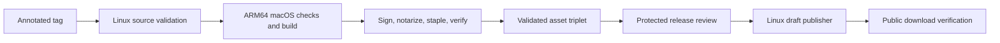

# Signed package releases

GitHub Actions builds and uploads the distribution packages. The release adapter
produces macOS product archives for the driver and background service. It does
not use Sparkle or distribute an application UI.

## Release unit and source identity

Every public release contains exactly three uploaded assets:

- `VolumeBridge-X.Y.Z.pkg`
- `Uninstall-VolumeBridge-X.Y.Z.pkg`
- `VolumeBridge-X.Y.Z-release.json`

The JSON binds both package names, byte lengths, final SHA-256 hashes, upload
hashes, and Apple submission IDs to one source commit and version. It also records
Apple team `4N949UKQ55`, ARM64 architecture, and the macOS 14.0 minimum. The manifest
is a provenance record; Apple signatures and stapled tickets provide package trust.

Use an annotated stable `vX.Y.Z` tag that points directly to a commit reachable
from canonical `acg-box/volume-bridge` main. The event, checkout, tag, and expected
cross-job commit must agree. The workspace version, Cargo.lock package version,
and both driver version fields must match the tag. Leading zeroes, prerelease
suffixes, lightweight tags, and tag objects that point to another tag are rejected.

A new version must advance every other remote stable tag and public stable
release. Never move or reuse a remote tag for different source. Source fixes
after a tag push require a new version, even if publication failed.

## Workflow boundaries



The source and package jobs have read-only repository permission. Checks and the
unsigned build finish before the signing step receives Apple credentials. The
package job requires an ARM64 macOS 26 runner and carries the source job's commit
and version into its own validation.

Only the Linux publisher has `contents: write`. It depends on both earlier jobs,
uses the `release` environment, and receives only the artifact, public source
metadata, and the ephemeral GitHub workflow token. It does not receive Apple
credentials. The workflow serializes releases and does not cancel an active one.

Keep the repository's `release` environment protected. The configured review
policy uses reviewer `acgxv`, permits self-review, and restricts deployments to
`v*` tags. The source validator enforces the narrower stable-version syntax.
Keep this environment free of signing secrets. Obtain authorization for the exact
release version before pushing its tag; review publication after package evidence
is complete. Do not weaken environment rules to finish a release.

## Shared credentials

The signing step consumes these organization-secret names:

| Secret | Purpose |
| --- | --- |
| `ACG_MACOS_DEVELOPER_ID_APPLICATION_P12_BASE64` | Encrypted Application certificate and private key, Base64 encoded. |
| `ACG_MACOS_DEVELOPER_ID_APPLICATION_P12_PASSWORD` | Application P12 password. |
| `ACG_MACOS_DEVELOPER_ID_INSTALLER_P12_BASE64` | Encrypted Installer certificate and private key, Base64 encoded. |
| `ACG_MACOS_DEVELOPER_ID_INSTALLER_P12_PASSWORD` | Installer P12 password. |
| `ACG_MACOS_NOTARY_API_KEY_ID` | App Store Connect Team Key ID. |
| `ACG_MACOS_NOTARY_API_ISSUER_ID` | Team Key issuer ID. |
| `ACG_MACOS_NOTARY_API_PRIVATE_KEY_P8` | Team Key private key in PEM format. |

Grant the repository effective access to the shared organization secrets. Do not
create repository or environment secrets with the same names. Keep recovery copies
in the owner's protected secret store. The legacy `APPLE_*` secrets are not used.
The notary key uses the Developer role. The signer derives identity labels from
the imported certificates; no identity-label secret or persistent publication
token is required.

## Signing and notarization

The signer removes credential variables from its child environment and writes
temporary material with restrictive permissions. It imports exactly one Developer
ID Application identity and one Developer ID Installer identity for the expected
team into an isolated keychain.

The temporary keychain is the sole search-list and default keychain only while
the key partition list is configured. The original default is then restored.
The signing keychain remains in the search list during packaging, because
`codesign` needs it to discover the identity and chain. On exit, including failure,
the signer restores and verifies both original settings before deleting its
temporary keychain and private files.

The service and driver receive Developer ID Application signatures with hardened
runtime and secure timestamps. Each product archive receives a Developer ID
Installer signature and trusted timestamp. Additional code entitlements are
rejected by the release verifier.

Each package submission is bound to its exact upload SHA-256 and Apple submission
ID. The signer waits at most 20 minutes, then checks both the status response and
notarization log for `Accepted`. The response IDs and logged upload hash must
match. Errors stop packaging; warnings are reported for inspection. It staples
the accepted ticket, validates it, rechecks the package signature, and requires
Gatekeeper install acceptance. Only then does the asset writer record the final
stapled bytes in the release manifest.

## Draft publication and public verification

The publisher validates the exact local asset triplet before any GitHub write.
It creates or reuses a private draft for the candidate tag and replaces only that
draft's assets. It downloads them again and compares their sizes, GitHub digests,
bytes, and source manifest to the validated CI artifact.

GitHub can give draft browser URLs an opaque `untagged-` slug. Draft verification
therefore downloads through authenticated asset IDs. After publication, every
asset must have the canonical versioned public URL, and verification uses those
public URLs. Temporary draft URLs are not accepted as public release URLs.

Immediately before publication, the publisher rechecks the remote annotated tag,
main ancestry, version advance, draft identity, and state. One final mutation
sets the draft public and marks it latest. An uncertain response is resolved by
fresh readback, not a blind repeat write. Public files are downloaded and verified
again. An already-public same-tag rerun is read-only and checks existing public
bytes rather than comparing them with a fresh signed build.

## Operator procedure

1. Complete review and merge the intended source into main. Confirm authorization
   for the exact version and tag.
2. Fetch canonical main and remote tags. Check version advance and all four
   product version fields.
3. Create the annotated tag at the intended commit. Run
   `node scripts/release/source.ts vX.Y.Z` before pushing that exact tag.
4. Inspect source, native build, signing, and notarization results. Approve the
   protected publisher only after those results pass.
5. Verify the successful workflow, public release, latest status, and downloaded
   artifact triplet. Inspect package signatures, stapled tickets, and Gatekeeper
   acceptance on macOS. Record hardware acceptance separately.

The local publisher check makes no GitHub requests:

```sh
node scripts/release/publish.ts --dry-run DIRECTORY VolumeBridge-X.Y.Z-release.json
```

## Recovery

An interrupted notarization retains the exact packages and JSON receipts under
`target/packages/release/`. Failed CI packaging retains a `notarization-recovery`
artifact for seven days. Preserve source identity, package bytes, upload hashes,
and submission IDs together.

At the same source revision, with matching built inputs, use the credential-injected
signer with `--resume` to query the retained submissions. It verifies the byte
binding and does not rebuild or upload a replacement package. Do not overwrite a
pending submission. Local recovery verification does not establish publication.

If publication is uncertain, inspect the exact release ID and assets before
another write. Do not replace public assets, move a tag, bypass notarization, or
manually publish a failed draft. See [acceptance](../verification/acceptance.md)
for the recorded runs and [installation and recovery](../workflows/installation-and-recovery.md)
for recovery on a destination Mac.
